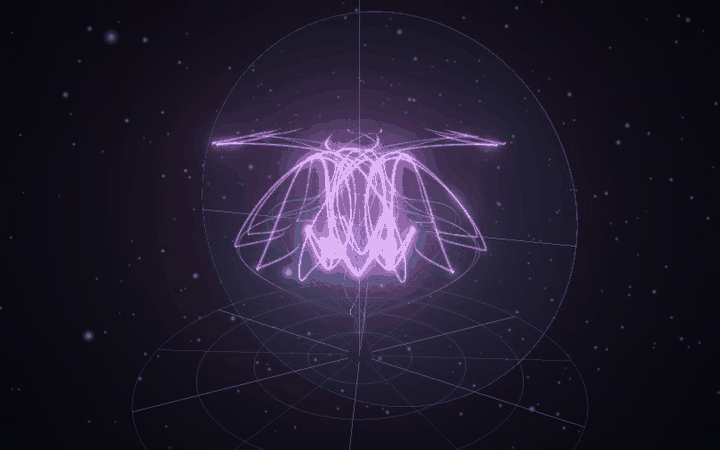
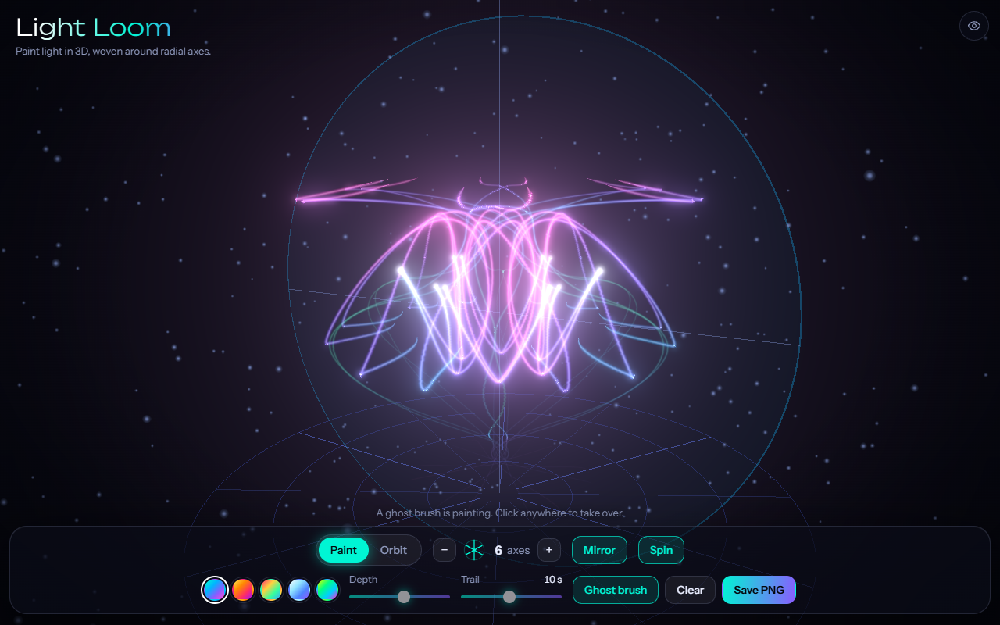

# Light Loom

Paint with light in 3D. Every stroke is woven around radial axes into a glowing neon sculpture, and the trails fade away like comets. Orbit the result, then save it as a PNG.

**Live demo:** https://jortegadmr.github.io/light-loom-3d/





## Features

- **Ghost brush.** The page starts painting a sculpture by itself; click or touch to take over.
- **Radial symmetry.** 1 to 16 axes around a vertical loom axis, plus an optional mirror for dihedral patterns. A floor guide shows the axes.
- **Real depth.** You paint on a vertical plane that follows the camera and slowly swings around the axis. The *Depth* control adds drift out of the plane, so strokes become true 3D curves, not flat kaleidoscope art.
- **Ribbons, not lines.** Width changes with pen speed (slow is fat, fast is thin), tails taper, and every ribbon has a white-hot head that cools into its palette colour.
- **Long-exposure trails.** Strokes fade out over a time you choose, from 2.5 seconds up to *Hold*, which keeps them until the buffer wraps.
- **Bloom and depth cues.** Additive HDR ribbons through `UnrealBloomPass`, with distance dimming and perspective-correct widths.
- **Orbit.** Paint and Orbit modes, right-drag or Shift/Space-drag to turn the sculpture while painting, wheel or pinch to zoom, two fingers on touch screens.
- **Five palettes**, and a UI that picks up the palette colour.
- **Save PNG**, keyboard shortcuts, responsive layout for phones, `prefers-reduced-motion` support and a message when WebGL 2 is missing.

### Shortcuts

| Key | Action |
| --- | --- |
| `O` | Toggle Paint / Orbit |
| `+` / `-` | More / fewer axes |
| `M` | Mirror |
| `R` | Spin |
| `G` | Ghost brush |
| `1` to `5` | Palette |
| `C` | Clear |
| `S` | Save PNG |
| `H` | Hide controls |

## Stack

TypeScript, [three.js](https://threejs.org/) (custom `ShaderMaterial`, `EffectComposer`, `UnrealBloomPass`, `OrbitControls`) and Vite. No external services; fonts are bundled.

## Run locally

```bash
npm ci
npm run dev      # development server
npm run build    # type-check and production build into dist/
npm run preview  # serve the production build
```

## How it works

All strokes live in one ring buffer of ribbon points (two vertices per point). The symmetry copies are not stored: the buffer is drawn once per copy with GPU instancing, and the vertex shader rotates or mirrors each instance around the Y axis. The same shader expands each point into a screen-space ribbon, computes fade, taper and colour from the point's age, and applies the palette. Painting casts the pointer ray onto a vertical plane through the axis; that plane's yaw oscillates over time and the stroke is offset along its normal by a wave that follows the path length, which is where the depth comes from.

## License

[MIT](LICENSE)
